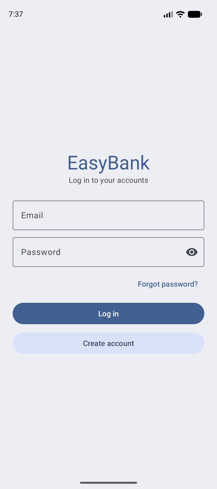
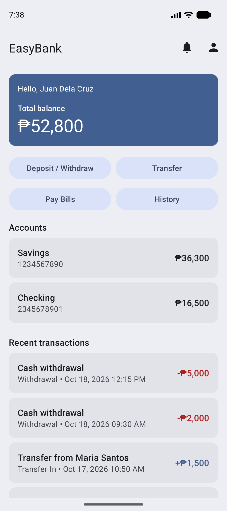
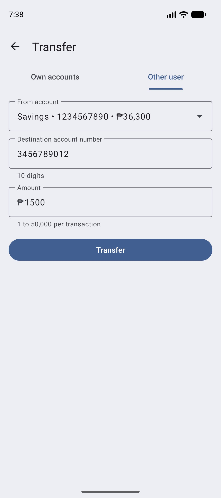
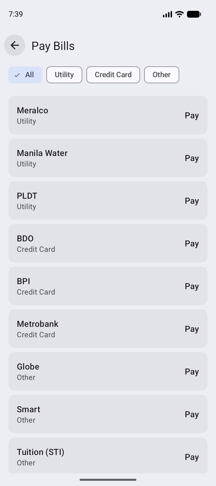
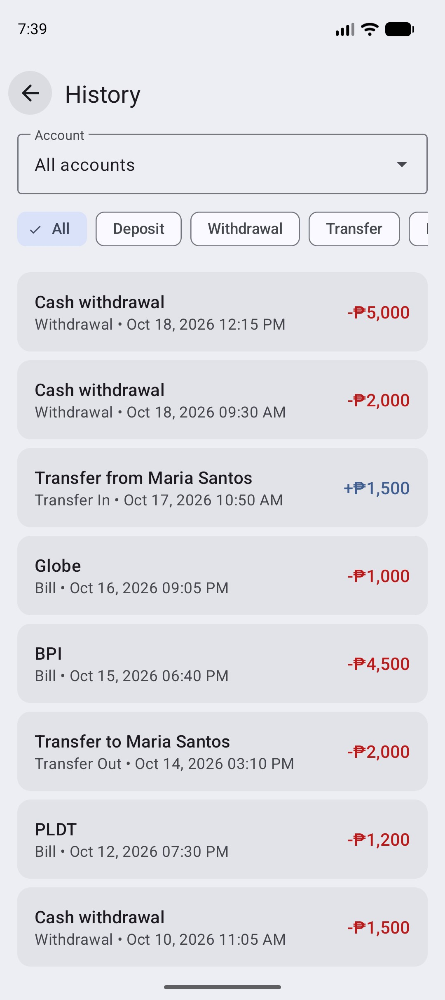
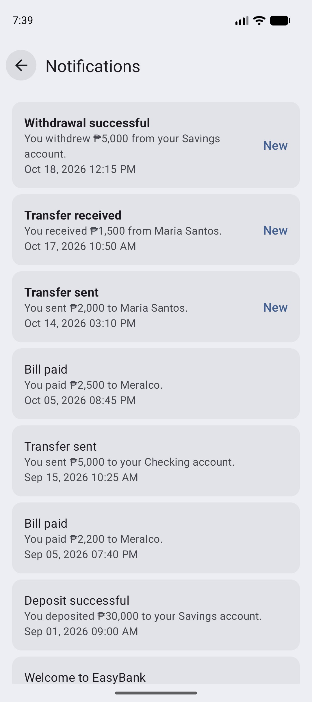

# EasyBank

An Android mobile banking app where customers check balances, deposit and withdraw, transfer funds, pay bills and read their transaction history and alerts. It is a fully simulated demo: no backend, no payment gateway, no email or SMS and no real push notifications.

**Core flow:** Log in → Pick an account → Transfer or pay a bill → Transaction recorded + notification

## About

EasyBank is a practice project built in preparation for the Tagisan ng Talino 2026 - 2027 Code Fest hackathon. It is based on the STI College Balayan Codefest Training AY 2023-2024, Problem #4: Mobile Banking App.

| | |
|---|---|
| Team Name | ERRAnds |
| Team Members | [Vrixzandro Eliponga](https://github.com/mowtiie), [Michael Tagle](https://github.com/ImmunoCapacity), [Christine Jane Lapuz](https://github.com/chrstnjn) |

## Features

**Registration and authentication**
- Sign up with full name, email, phone, password and confirm password. Email must be unique and valid, phone is 11 digits starting with `09`, password is 6+ characters
- Sign up also creates a Savings account with a 10-digit account number and a welcome notification
- Log in by email and password, and reset a forgotten password by email (no email is sent)

**Accounts**
- Home shows every account as a card (type, number, balance), the total balance and the 5 most recent transactions
- Open a new account from Profile: Savings, Checking, Payroll, Time Deposit or Student, starting at a zero balance
- Edit name, email and phone, change password, and log out with a confirmation

**Deposit and withdraw**
- Simulated cash movements of 1 to 50,000 per transaction
- Withdrawals fail with an inline error when the amount is more than the balance

**Fund transfer**
- Between your own accounts, or to another user by their 10-digit account number
- The owner's name is shown on a confirmation dialog before sending, and the receiver gets a notification
- Both balances and both transaction rows are written in one database transaction

**Bill payments**
- Billers grouped by Utility (Meralco, Manila Water, PLDT), Credit Card (BDO, BPI, Metrobank) and Other (Globe, Smart, Tuition STI), filtered with chips
- Pay with a 6 to 12 digit reference number and an amount

**Transaction history**
- Newest first, filtered by type (All, Deposit, Withdrawal, Transfer, Bill) and by account
- Outgoing amounts are shown as debits and incoming as credits. Tap a row for the full details

**Notifications**
- In-app only: a Toast when the event happens plus a row in the Notifications list
- Events: deposit, withdrawal, transfer sent and received, bill paid, account opened, profile and password changes, failed actions and low balance (below 500 after a debit)
- Unread rows are marked and become read when the screen opens, and Home shows the unread count

## Tech specs

| | |
|---|---|
| Language | Java 11 |
| UI | XML layouts, Material Design 3 (Material Components 1.14), view binding |
| Min / target SDK | 24 (Android 7.0) / 36 |
| Build | Android Gradle Plugin 9.2.1, Gradle 9.4.1 |
| Storage | Local SQLite for users, accounts, transactions and notifications |
| Theme | Material Theme Builder palette with light and dark mode |
| Navigation | One Activity per screen, no fragments |
| Libraries | AndroidX AppCompat, Material Components and ConstraintLayout only |

## Requirements

- Android Studio (a recent version that supports AGP 9.x) and JDK 11 or newer
- An Android emulator or device running Android 7.0 (API 24) or higher

## Getting started

```bash
git clone <repository-url>
cd EasyBank
./gradlew assembleDebug
```

Then open the project in Android Studio and press **Run** on an emulator. The debug APK is created at `app/build/outputs/apk/debug/`.

## Demo accounts

Both accounts use the password `demo1234`.

| User | Email | Accounts |
|---|---|---|
| Juan Dela Cruz | `demo@demo.com` | Savings `1234567890`, Checking `2345678901` |
| Maria Santos | `other@demo.com` | Savings `3456789012` |

Log in as Juan and transfer to `3456789012` to try a transfer to another user, then log in as Maria to see it arrive. Demo transactions and notifications are seeded when the database is first created, so no screen is empty. Maria's balance is under the low balance limit, so she already has a low balance alert.

## What is simulated

- Sign up, login, logout, profile edit and password reset are fake but validated.
- Deposits and withdrawals are simulated cash movements.
- Transfers and bill payments always succeed after a short fake processing screen, as long as the balance covers them.
- There is no real biller lookup. The reference number is only checked for format.
- Notifications are Toasts and a list inside the app. There are no real Android notifications.
- Amounts are whole pesos.
- Data is saved in local SQLite and persists across restarts. Only the logged-in user is kept in memory, so closing the app logs you out.

## Screenshots

<div align="center">
	<div>
         
         
         
         
         
         
	</div>
</div>

## Release build

```bash
./gradlew assembleRelease
```

Release signing is not configured in the project yet. Keystore files and `keystore.properties` must never be committed.

## Verification

APK releases on GitHub are signed using my key. They can
be verified using
[apksigner](https://developer.android.com/studio/command-line/apksigner.html#options-verify):

```
apksigner verify --print-certs --verbose easybank.apk
```

The output should look like:

```
Verifies
Verified using v1 scheme (JAR signing): false
Verified using v2 scheme (APK Signature Scheme v2): true
Verified using v3 scheme (APK Signature Scheme v3): false
Verified using v3.1 scheme (APK Signature Scheme v3.1): false
Verified using v3.2 scheme (APK Signature Scheme v3.2): false
Verified using v4 scheme (APK Signature Scheme v4): false
```

The certificate fingerprints should correspond to the ones listed below:

```
Owner: CN=Mowtiie
Issuer: CN=Mowtiie
Serial number: 8a256fdcdde50069
Valid from: Wed Jun 10 22:57:23 PST 2026 until: Sun Oct 26 22:57:23 PST 2053
Certificate fingerprints:
         SHA1: 56:4E:2C:DB:E4:06:C9:EC:15:E6:BC:D9:0A:88:38:72:8B:FB:13:20
         SHA256: 8B:67:51:F3:C3:31:85:63:5F:98:95:30:B6:C0:73:A1:39:7B:3D:41:2B:EF:AE:69:06:A2:EB:58:45:D2:DE:63
```

**Warning:** Only install EasyBank APKs signed with the key above. Verifying the signature confirms you're running a genuine, unmodified build.

### PGP Signing

As an additional layer on top of the Android signature above, each release is also signed with my PGP key. While `apksigner` confirms the APK itself is intact, a PGP signature confirms that *I* am the one who published this specific file to GitHub — an independent check that doesn't rely on GitHub's account security alone.

**Public key fingerprint:**
```
9EA2 8F46 7802 5092 7643 1B69 42B5 FA42 AA63 90E1
```

Download and import the key from my website, or directly from this repo:

```
curl -O https://mowtiie.cc/PGP_PUBLIC_KEY.asc
gpg --import PGP_PUBLIC_KEY.asc
```

After importing, confirm the fingerprint printed by GPG matches the one listed above — that match is what actually establishes trust, not the import step itself. Fetching the key over HTTPS from a domain you already trust is arguably a stronger anchor than a keyserver, since keyservers accept uploads from anyone and don't vouch for identity.

Each release includes a detached `.asc` signature alongside the APK. Verify a downloaded release with:

```
gpg --verify easybank-X.X.apk.asc easybank-X.X.apk
```

A valid signature looks like:

```
Good signature from "Mowtiie <mowtiie.dev@gmail.com>"
```

**Note:** PGP signing is a supplementary trust measure, not a substitute for the `apksigner` check above — verify both if you want the highest confidence that a release is genuine and unmodified.

## License

EasyBank is released under the [MIT License](LICENSE).
